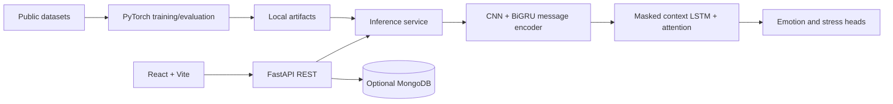

# EchoSafe

EchoSafe is an educational, non-clinical deep-learning prototype for analysing emotion categories and stress-related language patterns in voluntarily provided text. It is not a diagnostic tool, does not predict suicide risk, and cannot determine a person's actual mental state.

## What is included

- React/Vite frontend with chat analysis, journal, dashboard, history, resources, and a synthetic demo conversation.
- FastAPI backend with opt-in history, optional MongoDB, request validation, model metadata, experiments, and REST documentation.
- PyTorch CNN + BiGRU message encoder and masked context LSTM design, with task-specific emotion and stress heads.
- Reproducible dataset preparation, training, evaluation, explainability, uncertainty, and experiment scaffolding.
- Tests and Windows PowerShell setup.

The application works without MongoDB. A model checkpoint is optional for development; when one is not loaded, the API reports that state rather than pretending that a trained model exists. Any demo fallback is explicitly labelled as a software-pipeline fallback, not scientific inference.

## Windows setup

### Automated

From PowerShell:

```powershell
Set-ExecutionPolicy -Scope Process Bypass
.\start_project.ps1
```

### Manual

```powershell
cd backend
py -3 -m venv .venv
.\.venv\Scripts\Activate.ps1
pip install -r requirements.txt
uvicorn app.main:app --reload --port 8000
```

In another terminal:

```powershell
cd frontend
Copy-Item .env.example .env
npm install
npm run dev
```

Open `http://localhost:5173`. API docs are at `http://127.0.0.1:8001/docs`.

## ML workflow

The supported research datasets are GoEmotions (emotion), Dreaddit (stress-language), and EmpatheticDialogues (contextual emotion). See [dataset documentation](docs/dataset_documentation.md) before downloading anything. Raw data and checkpoints are ignored by Git.

```powershell
cd ml
pip install -r requirements.txt
python ..\scripts\prepare_data.py --synthetic
python ..\scripts\train_all.py --data-dir data\processed
```

Training must be run deliberately; no fabricated metrics are included. Results are written to `backend/artifacts/` and are surfaced by `/api/experiments` only when files exist.

## API

`GET /api/health`, `GET /api/model-info`, `POST /api/analyze`, `POST /api/analyze/conversation`, `GET /api/experiments`, `GET /api/experiments/plots`, `POST/GET/DELETE /api/history`, and `GET /api/resources`.

`POST /api/analyze` accepts `{ "text": "...", "context": ["..."] }`. Text is never logged and is never saved automatically.

## Architecture



## Safety and limitations

Scores are model confidence about language patterns, not psychological certainty. Explanations use approximate token occlusion. Results can be wrong, biased, uncertain, out of domain, or sensitive to spelling, sarcasm, and context. Do not use EchoSafe for monitoring, employment, education, medical, crisis, or other high-impact decisions. For immediate danger, contact local emergency services or a trusted person.

See [methodology](docs/methodology.md), [experiments](docs/experiments.md), and [privacy and safety](docs/privacy_and_safety.md).
